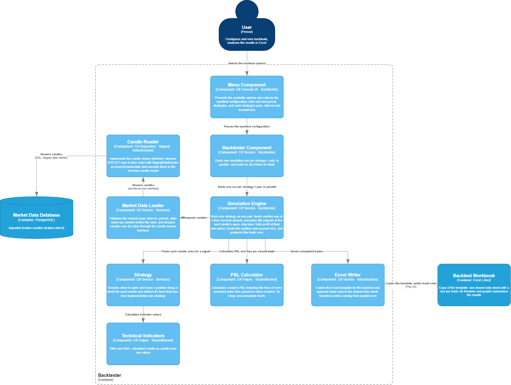

# Backtester

## Overview
The Backtester runs trading strategies against historical candle data and records every trade each strategy takes, so the results can be analysed in Excel.

## Starting a backtest
A backtest is started from a menu.

## Backtest configuration
Each backtest has:

- **Start period**
- **End period**
- **Strategies** to run

Each strategy in the backtest has its own settings:

- **Currency pair(s):** one or more. Different strategies can use different pairs.
- **Interval:** the candle size. Different strategies can use different intervals.
- **Account size:** the amount in US dollars the account can buy with.
  - **Every pair gets the full account size.** A strategy with $10,000 trading BTC/USD and ETH/USD has $10,000 for each pair.
  - **Pairs quoted in another currency** (e.g. ETH/EUR) use the account size converted into that currency. The conversion happens **once, at the start of the backtest**, using the **historical exchange rate at the backtest's start period**, taken from the exchange's imported candles (e.g. EUR/USD).
- **Stop loss:** every strategy has a fixed stop loss. Its size is defined by each strategy in code, not chosen in the menu.

Leverage is not supported for now. It may be added in the future, but a strategy can only buy with the account size it has.

**Short positions are simulated.** No coins are borrowed: a short profits when the price falls and loses when it rises, sized from the same account size as a long.

## Execution flow
1. Start the Backtester and open the menu.
2. Configure the backtest: start and end period, which strategies to run, and each strategy's pairs, interval and account size.
3. Start the backtest. The Excel template is copied to create this backtest's workbook, and every selected strategy begins running.
4. Each strategy runs on each of its pairs separately, in parallel with the other strategies.
5. When a strategy finishes, its trades are appended as rows to the workbook's shared data sheet.
6. The template's formulas and graphs update automatically from the written trades.

## Architecture
C4 component diagram of the Backtester:

The editable source, which also has the System Context and Containers pages, is [images/tradeR_c4.drawio](images/tradeR_c4.drawio).

### Layers
- **Services** is the application core. It holds:
  - the own models: candle, signal (with its reason), trade and position;
  - the strategy interface and the strategies;
  - the interfaces the core consumes, such as the historical candle source;
  - the Market Data Loader.
- **Infrastructure** holds the implementations of those interfaces:
  - the database candle reader, which converts rows into the Services candle model;
  - the Excel writer;
  - all database code (the Importer's data access moves here too);
  - the Kraken REST client, which stays a Kraken-specific detail.
- **Backtester** holds the menu, the simulation engine and the composition root (DI registration). The simulation engine lives here because simulated fills only make sense in a backtest.
- **Dependency rule:** Infrastructure → Services → SharedKernel. Services never references Infrastructure. An interface lives with the code that consumes it.

## Strategies
- A strategy receives **one candle at a time** and keeps only the state it needs, never the full candle history:
  - streaming indicators (`Create` + `Add`), which keep only their own window;
  - per-day values such as the previous day's high, low or VWAP. The strategy updates today's values on every candle. When a candle from a new day arrives, it saves them as the previous day's values and starts again.

## Parallel strategy execution
- Multiple strategies run in parallel.
- Strategies are independent of each other. One strategy's execution does not affect another's.
- A strategy with several pairs runs on each pair separately. Each pair is traded on its own, not as one combined portfolio.

## Results
- **One Excel workbook per backtest**, created by copying an Excel template, which will be provided.
- **The template has one shared data sheet**, and it's the only sheet the Backtester writes to. Every strategy's trades go into it.
- **Each trade is one row**, with these columns:

| Column | Description |
|---|---|
| Asset pair | The pair traded, e.g. BTC/USD |
| Interval | The strategy's candle interval |
| Strategy name | Which strategy took the trade |
| Position | Long or Short |
| Coin amount | How many coins were bought or sold |
| Bought amount | The cost in the quote currency |
| Currency | The quote currency of the pair (EUR, CHF, USD), so results in different currencies aren't added together |
| Buy price | Price per coin of the buy order |
| Sell price | Price per coin of the sell order |
| Fees | Total fees of all executed orders of the trade (open + close) |
| P&L | Profit or loss, including the fees, in the pair's currency |
| Open time | When the position was opened (UTC) |
| Close time | When the position was closed (UTC) |
| Entry reason | What triggered the entry, as described by the strategy, e.g. "EMA 9 crossed above EMA 21" |
| Exit reason | What triggered the exit: the strategy's own description of its exit signal, Stop loss, Take profit, or End of backtest |

Hold time is calculated in the template from the open and close times.

- **Signals carry their reason.** A strategy's signal is more than "enter" or "exit": it also includes a description of why it fired, which becomes the Entry reason or Exit reason. Stop loss and take profit exits are detected by the engine, which writes those reasons itself.
- **Positions still open at the end date** are closed automatically when the backtest ends, at the **close price of the last candle**, with "End of backtest" as the Exit reason. They are written to the sheet like any other trade, but **don't count toward the total P&L**. The template's totals leave out rows with that Exit reason.

- The template's formulas operate on the shared data sheet and produce the aggregations and graphs automatically. The Backtester writes the trades and nothing else; all analysis lives in the template.
- Writing to the workbook must be thread-safe: strategies run in parallel and may finish at the same time, and they all write to the same sheet.

## Fills, fees and slippage
- **Signal fills:** entries and exits triggered by a strategy's signal are filled at the **next candle's open**. A signal produced on a candle's close is executed at the open of the following candle, so a trade never uses a price that wasn't known when the decision was made.
- **Stop loss and take profit fills:** they fill **at their own price** (the stop price or the take profit price) as soon as a candle's low or high reaches it:
  - Long: the stop loss fills when the candle's low reaches the stop; the take profit when the candle's high reaches the target.
  - Short: the stop loss fills when the candle's high reaches the stop; the take profit when the candle's low reaches the target.
- **Fees:** the fee is passed to the generic P&L calculator (SharedKernel) when it's created. The Backtester passes Kraken's fee.
- **Slippage:** ignored.

## Data
- Candles come from the imported Kraken OHLCVT data (`kraken.ohlcvt`). Trade (time & sales) data is not used.
- **Candles are streamed, never fully loaded.** They're read in time order as an `IAsyncEnumerable` backed by an `NpgsqlDataReader`, so memory stays flat however long the period is. The `UNIQUE (asset_pair, interval_minutes, timestamp)` index supports this ordered range read.
- **Each run** (strategy × pair) holds one database connection while it streams. The default pool of 100 connections is enough for now.
- **Timeouts:**
  - Connection Lifetime is only checked when a connection goes back to the pool, so it doesn't cut off a running stream.
  - Command Timeout (30 s) applies to each wait for data from the server. Sitting on a debugger breakpoint is the only realistic way to exceed it.
- **A database error mid-stream** propagates as an exception.

## Open questions
- **Both levels in one candle (deferred):** if a single candle's range reaches both the stop loss and the take profit, the candle doesn't say which came first. Not decided yet. Options: count the stop loss (conservative), or look at smaller-interval candles to decide.
- **Warm-up:** indicators need candles before the start date (a 200-period EMA has no value for its first 199 candles), and so do per-day values (there's no previous day on the first day). Not decided yet:
  - how many candles before the start date to stream;
  - who decides that number (each strategy?).
  
  Candles before the start date feed the strategy, but no trades are taken on them.
- **Day boundary:** crypto trades 24/7, so a "day" needs a definition. Not decided yet whether it's midnight UTC or a cut-off each strategy chooses. A new day should be detected by comparing candle dates, not by counting candles, because Kraken skips minutes with no trades.
